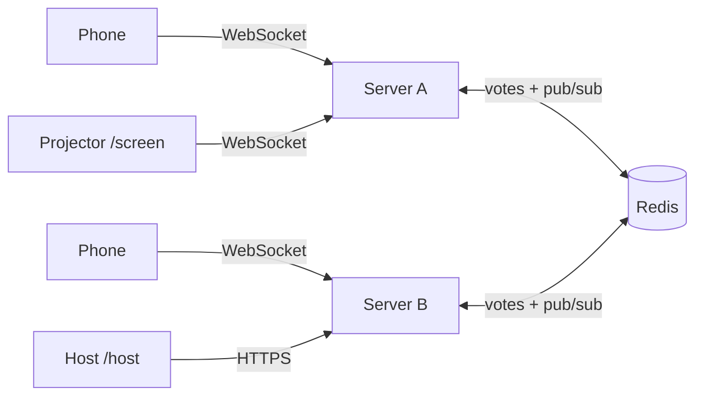
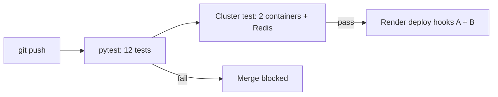

# ⚡ LivePoll: real-time quiz across multiple servers

A Kahoot-style live poll. The audience scans a QR code and votes from their phones; results animate on the projector as votes arrive. It runs as **two identical WebSocket servers kept in sync through Redis pub/sub**, so a vote cast on server A appears instantly for people connected to server B. The page always shows which server you're on, and the projector shows how many votes each server handled.

**Live demo:** `https://<server-a>.onrender.com/screen` <!-- fill in after deploying -->

## Pages

| URL | Who | What it does |
|---|---|---|
| `/join` | audience (QR code) | Sends each phone to server A or B, alternating (simple load balancing) |
| `/` | audience | Big colored answer buttons, vote locks in, shows connected server |
| `/screen` | projector | Live animated bars, vote count, QR code, per-server vote counts |
| `/host` | you | Pick a preloaded question or write your own, close voting, reset |
| `/docs` | developers | Auto-generated API docs (Swagger) |

## Architecture



1. A vote arrives at any server (WebSocket message).
2. The server stores it in Redis (`SADD` enforces one vote per client; `HINCRBY` counts it, also per server).
3. It publishes the updated results on a Redis channel.
4. **Every** server is subscribed, and forwards the message to its own connected browsers.

Servers hold no vote state, so they can be added, removed, or restarted freely.



## Tech stack

Python, FastAPI + WebSockets, Redis (pub/sub + counters), vanilla JS front end, Docker, GitHub Actions, Render, Upstash Redis.

## Run locally

```bash
docker compose up --build
```
Open `http://localhost:8001/screen` (projector), `http://localhost:8001/host` (host key: `host`), and `http://localhost:8002/` on another tab or phone on the same Wi-Fi. Votes cast on port 8002 show up live on the 8001 screen.

Tests only (no Docker or Redis needed; uses in-memory fakeredis):
```bash
pip install -r requirements-dev.txt
pytest -v
```

## Deploy for free (one-time setup)

**1. Redis:** create a free database at upstash.com and copy its `rediss://...` connection URL. (Render's own free Key Value instance also works if your account offers it. Check current limits.)

**2. Two Render web services** (New → Web Service → connect this repo), repeated for A and B:

| Setting | Value |
|---|---|
| Runtime | Docker, Instance type **Free** |
| Auto-Deploy | **Off** (GitHub Actions triggers deploys) |
| Health check path | `/health` |
| `INSTANCE_NAME` | `A` (and `B` for the second) |
| `HOST_KEY` | a password only you know |
| `REDIS_URL` | the Upstash `rediss://...` URL |
| `PEERS` | `https://<A>.onrender.com,https://<B>.onrender.com` (add after both services exist) |

**3. GitHub secrets:** in each Render service open Settings → Deploy Hook and copy the URL into repo secrets `RENDER_HOOK_A` and `RENDER_HOOK_B`.

**4. Protect `main`:** Settings → Rules → Rulesets → require a pull request and the `test` check, so failing tests can't be merged.

Push to `main`: tests run, then the cluster test, then both services redeploy.

### Free-tier notes
- Free Render services sleep after 15 minutes without traffic, and the first request can take about a minute. **Open `/screen` and `/` a minute before presenting.**
- Free services restart occasionally; the page reconnects automatically.

## Demo script (2-3 minutes)

1. Show `/screen` on the projector with the QR code. Everyone joins.
2. From `/host`, start a preloaded question. Phones light up with the answer buttons.
3. Votes arrive and the bars animate. Point at the "Votes handled by Server A / Server B" chips: the audience is split across two servers but sees one result.
4. Close voting and the winner is highlighted.

## Design notes

- **Pub/sub fan-out vs sticky sessions:** servers share no memory. Redis is the single source of truth and the message bus, so no sticky sessions are needed.
- **Idempotent updates:** every message is a full results snapshot, so a missed or repeated message can't corrupt the display.
- **One vote per client:** enforced atomically in Redis, not in the browser.
- **Production improvements:** a real load balancer or autoscaling, Redis persistence and clustering, authentication for the host, rate limiting.
