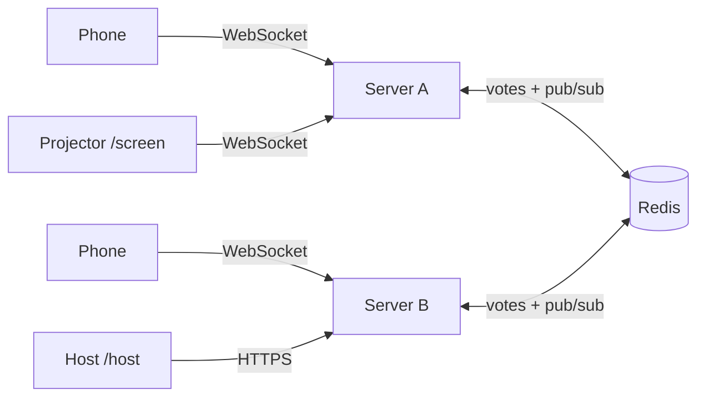
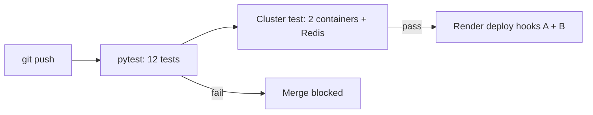

# ⚡ LivePoll: real-time quiz across multiple servers

A Kahoot-style live poll. The audience scans a QR code and votes from their phones; results animate on the projector as votes arrive. It runs as **two identical WebSocket servers kept in sync through Redis pub/sub**, so a vote cast on server A appears instantly for people connected to server B. The page always shows which server you're on, and the projector shows how many votes each server handled.

**Live demo:** `https://livepoll-a.onrender.com` 

## Pages

| URL | Who | What it does |
|---|---|---|
| `/join` | audience (QR code) | Sends each phone to server A or B, alternating (simple load balancing) |
| `/` | audience | Big colored answer buttons, vote locks in, shows connected server |
| `/screen` | projector | Live animated bars, vote count, QR code, per-server vote counts |
| `/host` | you | Pick a preloaded question or write your own, close voting, reset |
| `/docs` | developers | Auto-generated API docs (Swagger) |

## Architecture

1. A vote arrives at any server (WebSocket message).
2. The server stores it in Redis (`SADD` enforces one vote per client; `HINCRBY` counts it, also per server).
3. It publishes the updated results on a Redis channel.
4. **Every** server is subscribed, and forwards the message to its own connected browsers.

Servers hold no vote state, so they can be added, removed, or restarted freely.

## Tech stack

Python, FastAPI + WebSockets, Redis (pub/sub + counters), vanilla JS front end, Docker, GitHub Actions, Render, Upstash Redis.

