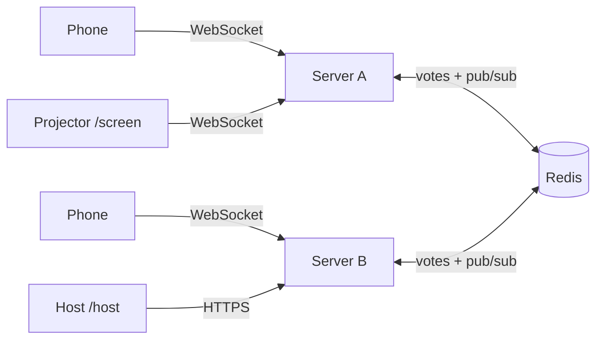
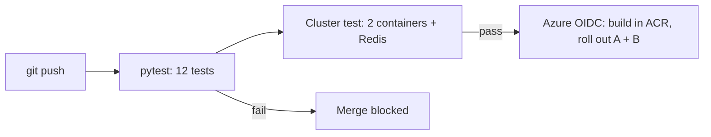

# ⚡ LivePoll: real-time quiz across multiple servers

A Kahoot-style live poll. The audience scans a QR code and votes from their phones; results animate on the projector as votes arrive. It runs as **two identical WebSocket servers kept in sync through Redis pub/sub**, so a vote cast on server A appears instantly for people connected to server B. The page always shows which server you're on, and the projector shows how many votes each server handled.

**Deployed on Azure Container Apps** — two identical servers + Redis, ~$0 at demo scale (see below).

## Pages

| URL | Who | What it does |
|---|---|---|
| `/join` | audience (QR code) | Sends each phone to server A or B, alternating (simple load balancing) |
| `/` | audience | Big colored answer buttons, vote locks in, shows connected server |
| `/screen` | projector | Live animated bars, vote count, QR code, per-server vote counts |
| `/host` | you | Pick a preloaded question or write your own, close voting, reset |
| `/docs` | developers | Auto-generated API docs (Swagger) |

## Architecture



1. A vote arrives at any server (WebSocket message).
2. The server stores it in Redis (`SADD` enforces one vote per client; `HINCRBY` counts it, also per server).
3. It publishes the updated results on a Redis channel.
4. **Every** server is subscribed, and forwards the message to its own connected browsers.

Servers hold no vote state, so they can be added, removed, or restarted freely.



## Tech stack

Python, FastAPI + WebSockets, Redis (pub/sub + counters), vanilla JS front end, Docker, GitHub Actions, **Azure Container Apps + Azure Container Registry**.

## Deploy to Azure (Azure for Students)

All infra lives in `azure/main.bicep` (ACR + Container Apps environment + Redis + servers A and B);
`azure/deploy.sh` wires it up in one command. Redis runs as an **internal-TCP container app** —
Azure Cache for Redis can't be created on new subscriptions (retiring, blocked for new customers),
and Container Apps has a free monthly grant (180k vCPU-seconds) that covers a demo.

**Best place to run it: [Azure Cloud Shell](https://shell.azure.com)** (Bash) — the CLI is preinstalled, no local setup.

```bash
git clone https://github.com/<you>/live-poll && cd live-poll
az login                       # sign in with your student account
./azure/deploy.sh
```

The script prints your URLs when done (takes a few minutes):

| URL | Who |
|---|---|
| `https://<a-url>/join` | audience — put this in the QR code |
| `https://<a-url>/screen` | projector |
| `https://<a-url>/host` | you (host key is printed and saved in `azure/.hostkey`) |

Re-running the script is safe (idempotent). Overrides: `LOCATION`, `RESOURCE_GROUP`, `BASE_NAME`, `HOST_KEY`, `IMAGE_TAG`.

### Continuous deployment (GitHub Actions, OIDC — no secrets to leak)

```bash
GH_REPO=<you>/live-poll ./azure/deploy.sh github-oidc
```

Then add the printed values as repo secrets (`AZURE_CLIENT_ID`, `AZURE_TENANT_ID`, `AZURE_SUBSCRIPTION_ID`)
and variables (`RESOURCE_GROUP`, `ACR_NAME`, `APP_A`, `APP_B`). Every push to `main` builds the image
in ACR and rolls it out to both servers.

### Cost & teardown

At demo size (3 × 0.25 vCPU replicas) everything fits in the Container Apps **free grant** for short use;
beyond that it's a few dollars a month against your $100 student credit. Everything lives in one
resource group — wipe it when you're done:

```bash
az group delete -n rg-livepoll --yes --no-wait
```

### Troubleshooting

- **Servers stuck in "Waiting"/Crashing**: image pull — check role assignment `az acr role assignment list --assignee-object-id <sp> --scope $(az acr show -n <acr> --query id -o tsv)`, or just re-run `./azure/deploy.sh`.
- **Votes not syncing**: `az containerapp logs show -g rg-livepoll -n <redis-app> --container redis` and the same for servers A/B. Redis is reachable from the poll apps as `redis://<redis-app-name>:6379` (short name, internal TCP ingress).
- **Host key changed**: it's generated once and kept in `azure/.hostkey`; pass `HOST_KEY=...` to pin it.

